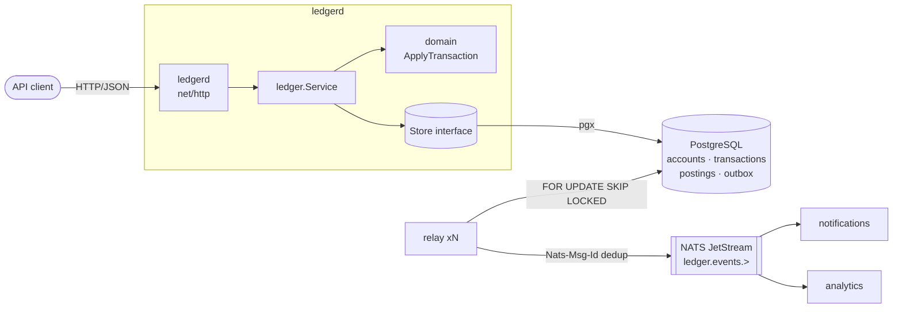

# ledgerflow

[](https://github.com/jakhongirjp/ledgerflow/actions/workflows/ci.yml)


A double-entry ledger service in Go. It is the kind of core money-movement
component a wallet, marketplace or fintech product builds on. It guarantees
that money is never created or destroyed, that retries are safe, and that
downstream systems learn about every posting exactly as it happened.

## Highlights

- **Double-entry invariants in one place.** Every backend calls the same pure
  `domain.ApplyTransaction`, so debits always equal credits, currencies never
  mix and overdrafts are rejected atomically.
- **Safe under concurrency.** Account rows are locked with `SELECT … FOR UPDATE`
  in primary-key order, which serializes overlapping transfers without
  deadlocks. A `CHECK` constraint is a second line of defence against negative
  balances.
- **Idempotent writes.** `Idempotency-Key` is required on every posting. A
  replay returns the original result (`200` + `Idempotent-Replayed: true`); the
  same key with a different body returns `409`.
- **Transactional outbox.** Events are written in the same DB transaction as the
  postings, then a relay publishes them to NATS JetStream. Several relay
  replicas can run side by side thanks to `FOR UPDATE SKIP LOCKED`, and the
  outbox ID doubles as the JetStream dedup key.
- **Production hygiene.** Structured JSON logs, request IDs, Prometheus
  metrics with bounded label cardinality, RFC 9457 problem responses, graceful
  shutdown, distroless non-root images.
- **One contract test suite, two backends.** `internal/store/storetest` runs the
  same behavioural tests against the in-memory store and real PostgreSQL,
  including a 40-goroutine race on a single account.

## Architecture



### Posting a transaction

```mermaid
sequenceDiagram
    participant C as Client
    participant L as ledgerd
    participant DB as PostgreSQL
    participant R as relay
    participant N as JetStream
    C->>L: POST /v1/transactions (Idempotency-Key)
    L->>DB: lookup key (fast replay path)
    L->>DB: BEGIN; SELECT accounts FOR UPDATE ORDER BY id
    L->>L: domain.ApplyTransaction (validate + compute)
    L->>DB: INSERT transaction ON CONFLICT DO NOTHING
    L->>DB: UPDATE balances, INSERT postings, INSERT outbox
    L->>DB: COMMIT
    L-->>C: 201 Created
    R->>DB: claim unpublished rows (SKIP LOCKED)
    R->>N: publish, wait for ack
    R->>DB: mark published
```

## Project layout

```
cmd/ledgerd           HTTP API binary
cmd/relay             outbox → JetStream relay binary
internal/domain       accounting model and invariants (no I/O)
internal/ledger       application service + Store port
internal/store/...    memory and postgres adapters + shared contract tests
internal/outbox       relay loop, Postgres source, JetStream publisher
internal/httpapi      routes, middleware, metrics, error mapping
migrations            embedded SQL, applied under an advisory lock
docs/adr              architecture decision records
```

## Quick start

```bash
docker compose up --build -d      # postgres, nats, ledgerd, 2x relay

# open accounts
BANK=$(curl -s localhost:8080/v1/accounts -d '{"name":"Bank","type":"asset","currency":"USD","allow_negative":true}' | jq -r .id)
ALICE=$(curl -s localhost:8080/v1/accounts -d '{"name":"Alice","type":"liability","currency":"USD"}' | jq -r .id)

# top up Alice's wallet with $25.00 (amounts are minor units)
curl -s localhost:8080/v1/transactions -H 'Idempotency-Key: topup-1' -d "{
  \"description\": \"card top-up\",
  \"entries\": [
    {\"account_id\": \"$BANK\",  \"direction\": \"debit\",  \"amount\": 2500},
    {\"account_id\": \"$ALICE\", \"direction\": \"credit\", \"amount\": 2500}
  ]}" | jq

curl -s localhost:8080/v1/accounts/$ALICE | jq .balance   # 2500
```

Without Docker: `make run` starts the API with the in-memory store.

## API

| Method | Path | Description |
|---|---|---|
| `POST` | `/v1/accounts` | Open an account (`asset`, `liability`, `equity`, `revenue`, `expense`) |
| `GET` | `/v1/accounts/{id}` | Account with current balance and version |
| `GET` | `/v1/accounts/{id}/postings?limit=` | Most recent postings with running balance |
| `POST` | `/v1/transactions` | Post a balanced transaction. Requires `Idempotency-Key` |
| `GET` | `/v1/transactions/{id}` | Transaction with its entries |
| `GET` | `/healthz`, `/readyz`, `/metrics` | Liveness, readiness (DB ping), Prometheus |

Errors use `application/problem+json`:

| Status | `type` | When |
|---|---|---|
| 400 | `urn:ledgerflow:missing_idempotency_key` | header missing |
| 404 | `urn:ledgerflow:not_found` | unknown account or transaction |
| 409 | `urn:ledgerflow:idempotency_conflict` | key reused with a different body |
| 422 | `urn:ledgerflow:validation_failed` | unbalanced, non-positive amount, bad currency |
| 422 | `urn:ledgerflow:insufficient_funds` | would overdraw a non-negative account |
| 422 | `urn:ledgerflow:currency_mismatch` | accounts in different currencies |

Balances are expressed on each account's normal side: assets and expenses grow
with debits, liabilities, equity and revenue grow with credits.

## Development

```bash
make test               # unit + contract tests on the memory store
make test-integration   # also runs the Postgres suite (needs a server)
make lint               # golangci-lint v2
```

Postgres tests create a throwaway database per test and drop it afterwards, so
they are safe to run in parallel against a shared server. CI runs them against
a `postgres:16` service container.

### Configuration

| Variable | Default | |
|---|---|---|
| `LEDGER_HTTP_ADDR` | `:8080` | listen address |
| `LEDGER_STORE` | `postgres` | `postgres` or `memory` |
| `DATABASE_URL` | | required for postgres |
| `NATS_URL` | | relay logs events if unset |
| `LEDGER_SUBJECT_PREFIX` | `ledger.events` | JetStream subject prefix |
| `RELAY_INTERVAL` / `RELAY_BATCH_SIZE` | `1s` / `100` | relay polling |
| `LOG_LEVEL` | `info` | `debug`, `info`, `warn`, `error` |

## Design decisions

- [ADR-0001: Pessimistic row locks over optimistic retries](docs/adr/0001-pessimistic-locking.md)
- [ADR-0002: Transactional outbox for event delivery](docs/adr/0002-transactional-outbox.md)
- [ADR-0003: Integer minor units for money](docs/adr/0003-integer-minor-units.md)

## Roadmap

- Multi-currency transfers through FX clearing accounts
- Balance snapshots for fast historical queries
- gRPC transport generated from the same service layer
- OpenTelemetry tracing across ledgerd, relay and consumers

## License

MIT
