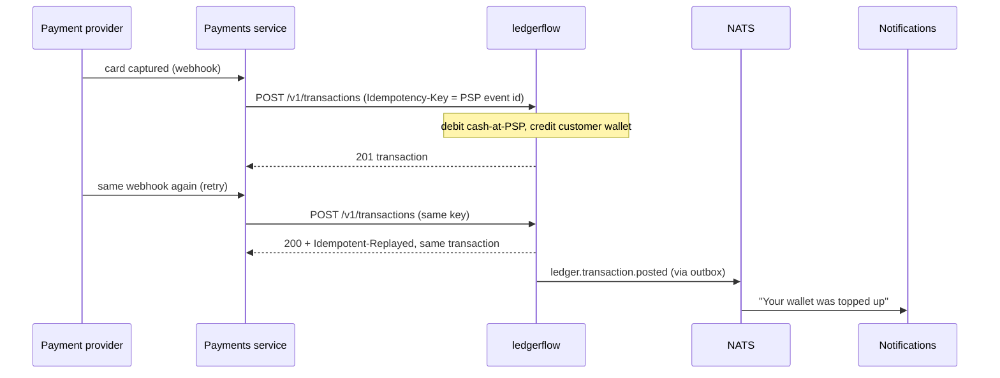

# Product: vision and requirements

## Vision

Every product that moves money (wallets, marketplaces, payouts, loyalty points)
eventually rebuilds a ledger, usually as a `balance` column that drifts from the
truth. ledgerflow is the ledger those teams should have started with: a small
service that records money movement as balanced double-entry transactions, never
loses or duplicates a posting, and tells the rest of the company what happened.

**Who it's for.** Product engineering teams at fintechs and marketplaces, and
the finance team that has to reconcile what those products did.

**What success looks like.**
- Balances can be rebuilt from postings at any time, and always match.
- A retried request can never move money twice.
- Finance can answer "why is this balance X?" from the ledger alone.

## Business problem

| Today | Cost |
|---|---|
| Balances updated in place by whichever service handles a payment | Drift between services, manual reconciliation every month-end |
| Retries after timeouts | Duplicate credits and debits that support has to reverse by hand |
| Downstream systems polled for changes | Notifications, analytics and fraud checks see money moves late or not at all |
| No immutable history | Audit requests take days of log archaeology |

## Business requirements

| ID | Requirement |
|---|---|
| BR-1 | Every movement of value is a transaction whose debits equal its credits. |
| BR-2 | Posted transactions are immutable. Corrections are new, reversing transactions. |
| BR-3 | A client can safely retry any write without creating a duplicate. |
| BR-4 | Accounts that represent customer funds can't go negative. |
| BR-5 | Other systems learn about each posted transaction within seconds, at least once. |
| BR-6 | The history of any account, with running balance, is available on demand. |
| BR-7 | Amounts are exact; no floating-point money anywhere. |

## Technical requirements

| ID | Requirement | How it is met |
|---|---|---|
| TR-1 | Atomic posting across many accounts | Single Postgres transaction; account rows locked `FOR UPDATE` in ID order to avoid deadlocks |
| TR-2 | Idempotency | `Idempotency-Key` header stored with a SHA-256 of the request; a replay returns the same transaction with `200` and `Idempotent-Replayed: true`; a different body is a `409` |
| TR-3 | Exactly-once effect, at-least-once delivery | Transactional outbox written in the same transaction, relayed to NATS JetStream with `FOR UPDATE SKIP LOCKED` |
| TR-4 | Integer minor units | `BIGINT` amounts, ISO 4217 currency per account, currency mismatch rejected |
| TR-5 | Invariants enforced twice | Domain validation in Go, plus `CHECK` constraints in the schema |
| TR-6 | Latency | p99 under 50 ms for a two-leg transfer at 500 rps on a single primary (target; load test is milestone M5) |
| TR-7 | Operability | JSON logs, Prometheus metrics, `/healthz` and `/readyz`, graceful shutdown |
| TR-8 | Portability | Single static binary in a distroless image; configuration from environment only |

## Out of scope (for now)

- Foreign exchange inside one transaction (planned: FX clearing accounts, M6)
- End-user authentication. ledgerflow is an internal service behind a gateway; see
  [engineering.md](engineering.md#authentication-and-authorisation).
- Payment-rail integrations. Those are producers of ledger transactions, not part of it.

## Business workflow: wallet top-up

